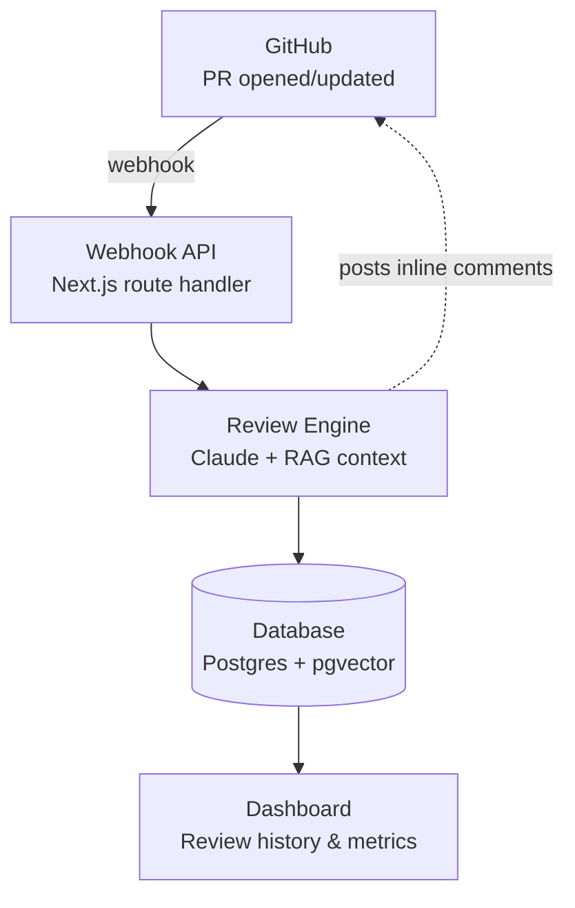

<div align="center">

# Argus

**AI code review that reads the whole codebase, not just the diff.**


<!-- TODO: swap this for a real annotated-diff GIF once Phase 6 (dashboard) is live.
     This is the single most important asset in this README — lead with proof, not description. -->
<!--  -->

</div>

---

## Why Argus

Most automated review tools — linters, static analyzers, even a lot of the AI-powered ones — look at a pull request the same way: in isolation. They can tell you a diff has a syntax issue or matches a known bad pattern, but they have no idea whether that change contradicts how the rest of your codebase actually works, because they never look at the rest of your codebase.

Argus does. It installs as a GitHub App, indexes the whole repository it's watching, and reviews every pull request with that context in hand — so it can catch the kind of issue a thoughtful senior reviewer would catch and a line-by-line linter can't: *"this duplicates logic that already lives in `utils/auth.ts`,"* or *"this query isn't parameterized, and the function in the file right next to it already handles this correctly."*

## How it works



1. **GitHub** sends a webhook the moment a PR is opened or updated.
2. The **webhook API** verifies it, then fetches the diff and changed files.
3. The **review engine** retrieves relevant context from the rest of the codebase (via a vector index, not just the diff), sends it all to Claude with a structured review prompt, and gets back categorized findings.
4. Findings are **posted back to the PR** as inline comments, and stored in **Postgres** for the dashboard to chart over time.

## Features

- 🔗 **GitHub-native** — installs as a GitHub App, reviews are posted as normal PR comments, no extra workflow to learn
- 🧠 **Full-codebase context** — retrieval-augmented review, not diff-only analysis
- 🏗️ **Architectural feedback** — flags changes that conflict with existing patterns elsewhere in the repo
- 🔒 **Security flags** — LLM-based reasoning backed by a deterministic Semgrep pass, so flags aren't just "the AI said so"
- 📊 **Quality dashboard** — review history and code quality trends per repository, over time

## Tech stack

| Layer | Technology |
|---|---|
| Frontend | Next.js (App Router), TypeScript, Tailwind CSS |
| Auth | GitHub OAuth (Auth.js) |
| GitHub integration | GitHub App + Octokit |
| Backend / API | Next.js Route Handlers |
| Context retrieval | pgvector + Voyage AI embeddings |
| Review engine | Anthropic Claude API |
| Security scanning | Semgrep |
| Database | PostgreSQL (Supabase) |
| Hosting | Vercel |

## Getting started

### Prerequisites

- Node.js 20+ and npm
- A [Supabase](https://supabase.com) project with the `pgvector` extension enabled
- A GitHub App **and** a separate GitHub OAuth App ([see setup notes](#setup-notes))
- API keys for [Anthropic](https://console.anthropic.com) and [Voyage AI](https://dash.voyageai.com)

### Installation

```bash
git clone https://github.com/<your-username>/argus.git
cd argus
npm install
cp .env.example .env.local   # fill in the values described below
npm run dev
```

### Environment variables

| Variable | Description |
|---|---|
| `GITHUB_APP_ID` | From your GitHub App's settings page |
| `GITHUB_APP_CLIENT_ID` | From your GitHub App's settings page |
| `GITHUB_APP_PRIVATE_KEY` | The `.pem` private key downloaded from the App settings |
| `GITHUB_WEBHOOK_SECRET` | The secret you set when creating the App |
| `GITHUB_OAUTH_CLIENT_ID` | From the separate GitHub OAuth App |
| `GITHUB_OAUTH_CLIENT_SECRET` | From the separate GitHub OAuth App |
| `DATABASE_URL` | Supabase Postgres connection string |
| `NEXT_PUBLIC_SUPABASE_URL` | Supabase project API URL |
| `SUPABASE_SERVICE_ROLE_KEY` | Supabase service role key (server-side only) |
| `ANTHROPIC_API_KEY` | From console.anthropic.com |
| `VOYAGE_API_KEY` | From dash.voyageai.com |
| `NEXTAUTH_SECRET` | Generate with `npx auth secret` |

### Setup notes

Argus needs **two separate GitHub apps**: a **GitHub App** (the bot that reads PRs and posts reviews) and a **GitHub OAuth App** (plain "Sign in with GitHub" for the dashboard). They're easy to conflate but serve different purposes — see `/docs/setup.md` *(coming soon)* for the full walkthrough.

## Project status

Argus is being built in public, phase by phase:

- [x] **Phase 0–1** — Project scaffold, GitHub App + OAuth App, database foundations
- [x] **Phase 2** — Webhook & diff pipeline
- [ ] **Phase 3** — Codebase indexing & retrieval (RAG) *(next)*
- [ ] **Phase 4** — Review engine (Claude-based structured findings)
- [ ] **Phase 5** — Security scanning & PR comments
- [ ] **Phase 6** — Dashboard
- [ ] **Phase 7** — Testing & refinement
- [ ] **Phase 8** — Docs & public launch

## Contributing

This started as a solo portfolio project, but issues and PRs are welcome once the core pipeline (through Phase 5) is stable. See `CONTRIBUTING.md`.

## License

[MIT](./LICENSE)

---

<div align="center">

Built by [Saksham](https://github.com/saksham101s) · named after Argus Panoptes, the many-eyed giant of Greek myth who never slept

</div>
